# Pitzki Widgets

**Little live cards for your Windows desktop.** A clock, the weather, your tasks, the stock market, your PC, your music, Discord and your games, each on its own small card that sits right on the wallpaper, under your windows, and never gets in the way. Pitzki, the night-sky cube from [Piztki](https://github.com/yahavpenso/Piztki), lives in them too: he juggles, plays guitar, opens CS2 cases and reacts to what the other cards say.

Free. No account, no ads, no tracking. **43 cards** to pick from.

  <a href="https://github.com/yahavpenso/PitzkiWidgets/releases/latest"><b>⬇ Download the latest version</b></a>
  &nbsp;·&nbsp; <a href="https://yahavpenso.github.io/PitzkiWidgets/">Website</a>
  &nbsp;·&nbsp; <a href="https://github.com/yahavpenso/PitzkiWidgets/wiki">Help pages</a>
  &nbsp;·&nbsp; <a href="#install">How to install</a>
  &nbsp;·&nbsp; <a href="#every-card">Every card</a>
  &nbsp;·&nbsp; <a href="#what-each-card-uses">What each card uses</a>
  &nbsp;·&nbsp; <a href="#games">Games</a>
  &nbsp;·&nbsp; <a href="#privacy">Privacy</a>

> Every clip below is the real app, filmed by its own built-in test. Everything personal in them (calendar, clipboard, Steam, Discord, games, music, photos) is made up for the demo.

---

## Pick your cards

Click the Pitzki Widgets icon next to the clock and choose **Widgets…**. Every card has a switch: turn it on and the card pops onto your desktop, turn it off and it leaves.

## Every card

### Everyday

<table>
<tr>
<td width="50%" valign="top"><b>Pitzki</b> Pitzki sits on your desktop, blinks, follows your mouse, and about once a minute does something: juggling, guitar, pizza, a CS2 case. He dances to your music and sleeps at night. 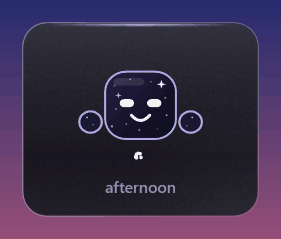</td>
<td width="50%" valign="top"><b>Clock</b> The time, big, with the date under it. Says morning, afternoon, evening or night. 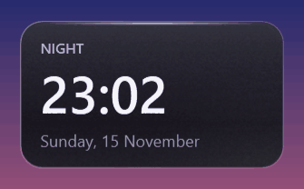</td>
</tr>
<tr>
<td width="50%" valign="top"><b>Calendar</b> This month at a glance, with today marked. 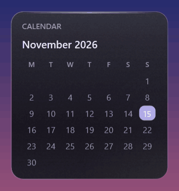</td>
<td width="50%" valign="top"><b>Weather</b> The temperature and the sky where you are, and Pitzki out in it: an umbrella in the rain, a hat in the snow, waving in the sun. 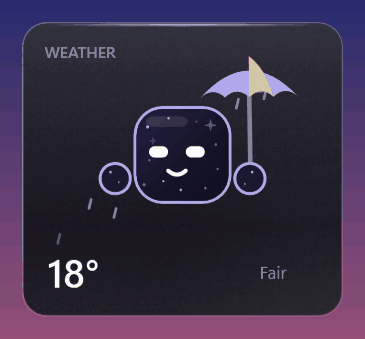</td>
</tr>
<tr>
<td width="50%" valign="top"><b>Note</b> A sticky note you type straight onto the desktop. It saves by itself. 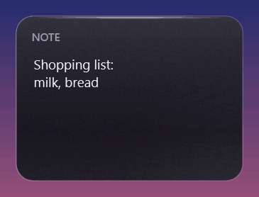</td>
<td width="50%" valign="top"><b>Tasks</b> A short to-do list. Tick things off, add with Enter, clear the done ones. 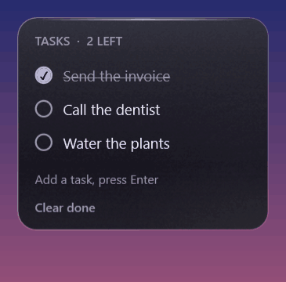</td>
</tr>
<tr>
<td width="50%" valign="top"><b>Timer</b> Count down any number of minutes. Pitzki dances when it is up. 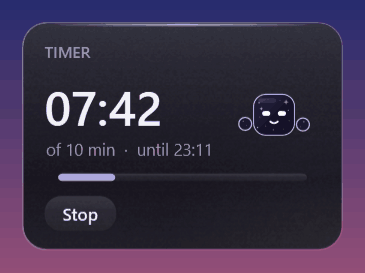</td>
<td width="50%" valign="top"><b>Focus rounds</b> 25 minutes of work, 5 of rest, a long break after every fourth round, and a count of today&#x27;s rounds. 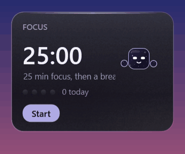</td>
</tr>
<tr>
<td width="50%" valign="top"><b>Countdown</b> How many days are left until a date that matters, with a bar of how far along you are. 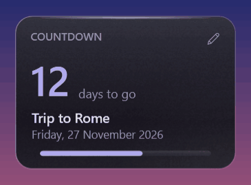</td>
<td width="50%" valign="top"><b>What&#x27;s next</b> The next things in the calendar of this PC (read only), with how long until each one. 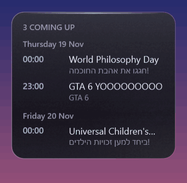</td>
</tr>
<tr>
<td width="50%" valign="top"><b>Calculator</b> Type a sum, a unit or money and the answer appears as you type: 12*(3+4), 5 km to mi, 20 usd to eur. 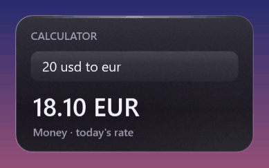</td>
<td width="50%" valign="top"><b>World clock</b> The time in three cities you choose, and how far ahead or behind they are. 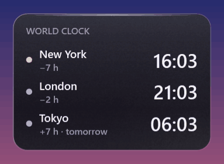</td>
</tr>
<tr>
<td width="50%" valign="top"><b>Photos</b> A picture frame for a folder of your photos. It moves on every few seconds. 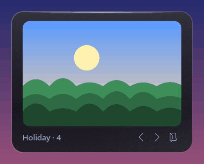</td>
<td width="50%" valign="top"><b>Shortcuts</b> Your favourite programs and folders as icons, one click away. Drag them in from Explorer. 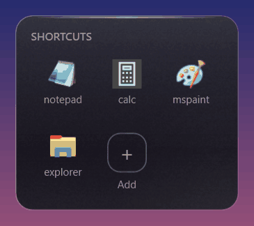</td>
</tr>
</table>

### Money

<table>
<tr>
<td width="50%" valign="top"><b>Stocks</b> Up to six stocks: the price, today&#x27;s move and a line of the day. A bell can tell you when one moves 2, 3, 5 or 10%. 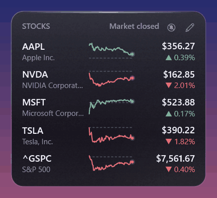</td>
<td width="50%" valign="top"><b>Stock chart</b> One stock, big, over a day, a week, a month, six months or a year. 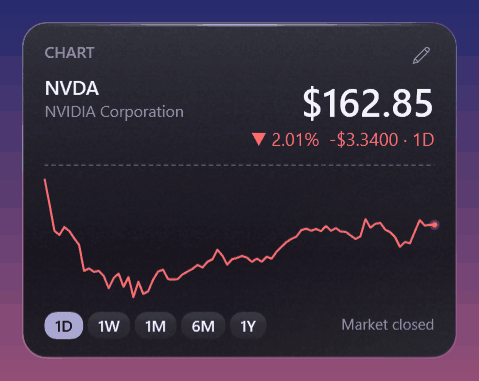</td>
</tr>
<tr>
<td width="50%" valign="top"><b>My portfolio</b> The shares you own: what they are worth now and how much you are up or down since you bought. 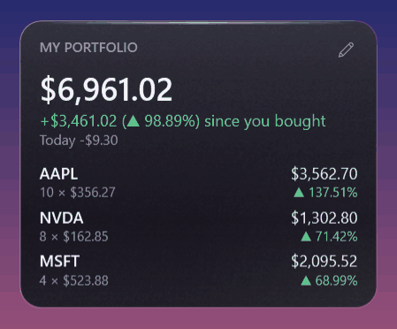</td>
<td width="50%" valign="top"><b>Indexes</b> The S&amp;P 500, Nasdaq, Dow Jones and Tel Aviv 35, live. 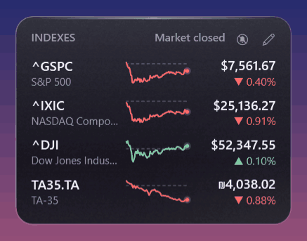</td>
</tr>
<tr>
<td width="50%" valign="top"><b>Market hours</b> When New York and Tel Aviv open and close, counting down, in your own time. 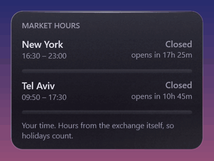</td>
<td width="50%" valign="top"><b>Pretend portfolio</b> $10,000 of play money: buy and sell real stocks at real prices, with no real money. 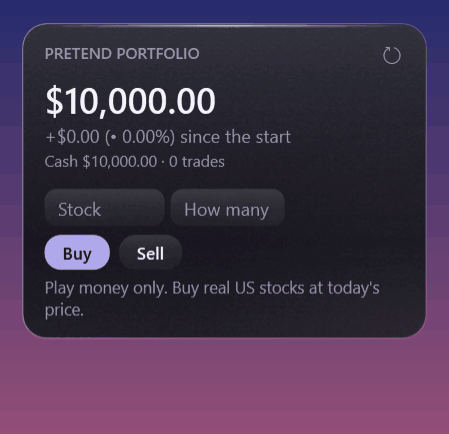</td>
</tr>
<tr>
<td width="50%" valign="top"><b>Higher or lower?</b> Will a stock be higher or lower tomorrow? Guess, and the card keeps score. 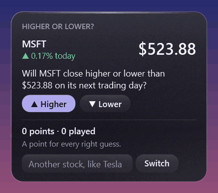</td>
<td width="50%" valign="top"><b>Market news</b> A fresh headline about each of your stocks. Click one to read it. 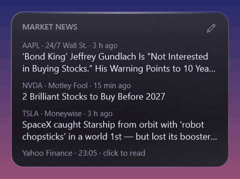</td>
</tr>
<tr>
<td width="50%" valign="top"><b>Crypto</b> Bitcoin, Ethereum and Solana, live, with a line of the day. 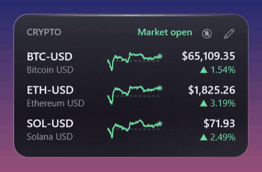</td>
<td width="50%" valign="top"><b>Dollar &amp; euro</b> The dollar and the euro in shekels, with a line of the week. 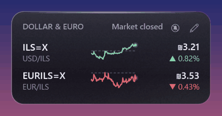</td>
</tr>
<tr>
<td width="50%" valign="top"><b>Money converter</b> Dollars, shekels, euros, pounds, yen and coins, at the rate right now. 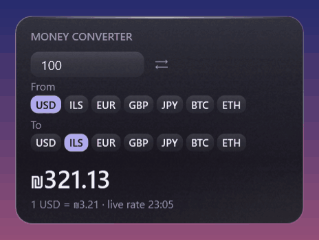</td>
<td></td>
</tr>
</table>

### Your PC

<table>
<tr>
<td width="50%" valign="top"><b>This PC</b> Processor, graphics, memory, network and how long the PC has been on, with a graph of the last minute. The pencil hides rows you don&#x27;t need. 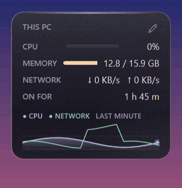</td>
<td width="50%" valign="top"><b>Drives</b> How much room is left on each drive. 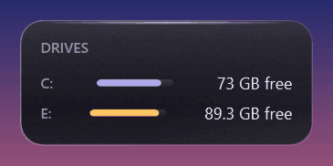</td>
</tr>
<tr>
<td width="50%" valign="top"><b>Batteries</b> Bluetooth headphones, mouse and controllers that report a battery, and the laptop itself. 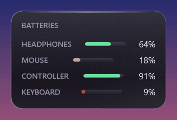</td>
<td width="50%" valign="top"><b>Copied</b> The last few things you copied. Click one to copy it again. Kept in memory only. 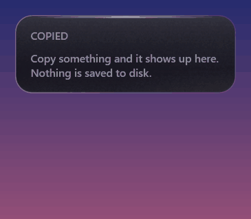</td>
</tr>
<tr>
<td width="50%" valign="top"><b>Clips</b> Your newest recording or screenshot, ready to open, with arrows to go back. 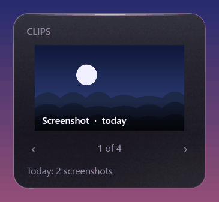</td>
<td width="50%" valign="top"><b>Screen time</b> How long you were at the PC today, the programs you used most, and the last seven days. 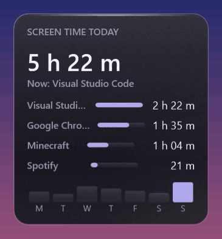</td>
</tr>
<tr>
<td width="50%" valign="top"><b>Claude usage</b> How much of your Claude plan is used, and when each limit resets. Needs Claude Code on this PC. 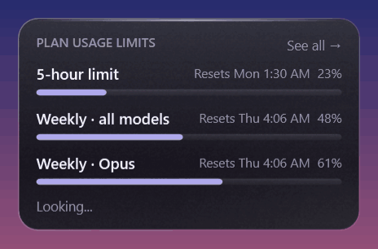</td>
<td></td>
</tr>
</table>

### Music and games

<table>
<tr>
<td width="50%" valign="top"><b>Music</b> Whatever is playing in any app (Spotify, a browser, anything), with the cover, real buttons, and a bar you can drag. Shows the line being sung when the song has timed lyrics. 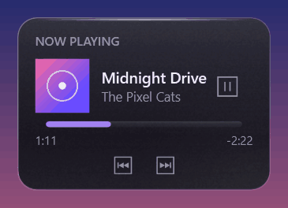</td>
<td width="50%" valign="top"><b>Discord</b> Your Discord voice channel: who is in it, who is talking, Mute and Deafen, and new messages. 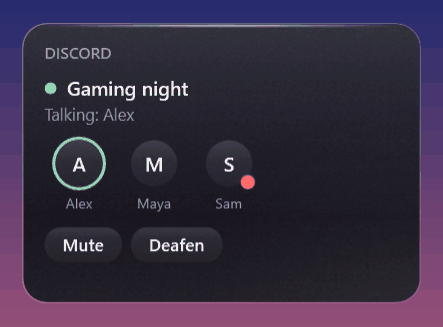</td>
</tr>
<tr>
<td width="50%" valign="top"><b>Sound</b> Who is using the microphone (with Mute mic), the camera, Discord&#x27;s Mute and Deafen, and a volume slider for every app. 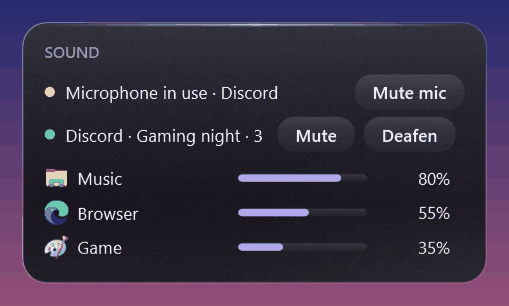</td>
<td width="50%" valign="top"><b>Steam</b> What Steam is downloading and how far along, how many games are running, or the game you played last. 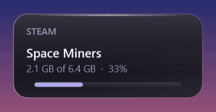</td>
</tr>
<tr>
<td width="50%" valign="top"><b>CS2 inventory</b> What your CS2 skins are worth, how it moved since yesterday, the days before, and your biggest movers. 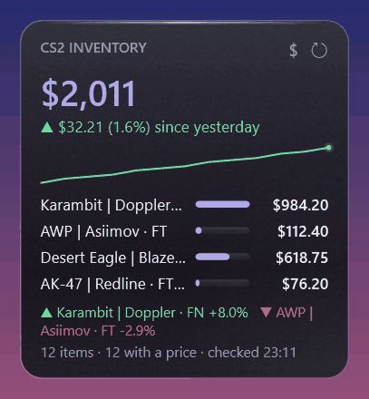</td>
<td width="50%" valign="top"><b>All my Steam</b> Your CS2 inventory and your Steam items together, in one number. 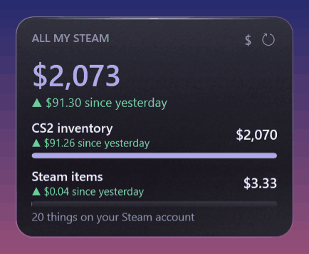</td>
</tr>
<tr>
<td width="50%" valign="top"><b>Skin watch list</b> Skins you want and the price you would pay. You get a note when one drops to your price. 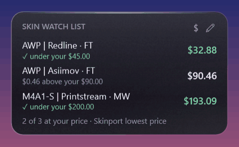</td>
<td width="50%" valign="top"><b>Is opening worth it?</b> Your CS2 cases: what opening one gives back on average, the chance to win, and the best drop. 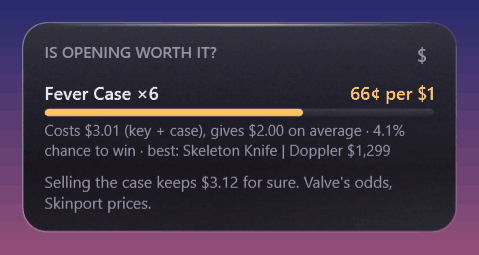</td>
</tr>
<tr>
<td width="50%" valign="top"><b>Steam items</b> What your Steam trading cards, backgrounds and emoticons are worth on the market. 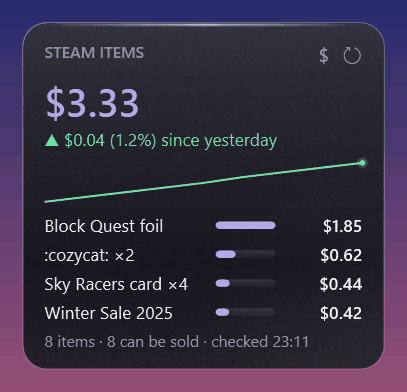</td>
<td width="50%" valign="top"><b>Game updates</b> What changed in the latest patch of the games you play on Steam. 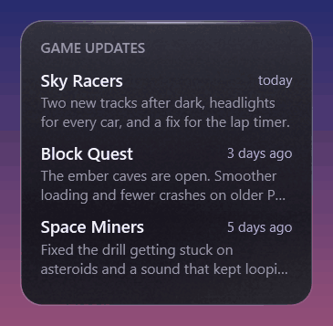</td>
</tr>
<tr>
<td width="50%" valign="top"><b>Last game</b> How your last game went, any game Pitzki summarises (CS2, Fortnite, Roblox...). ROB RUN shows live. 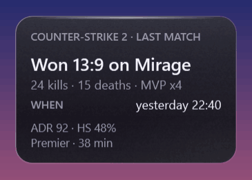</td>
<td></td>
</tr>
</table>

## Pitzki lives here

The Pitzki card is not a picture. About once a minute he does something of his own, he dances when music plays, sleeps at night, follows your mouse with his eyes, and reacts to the other cards (a full drive, a stock that jumped, a new clip, a game you won).

<table>
<tr>
<td width="33%" valign="top" align="center"> Guitar</td>
<td width="33%" valign="top" align="center"> Pizza</td>
<td width="33%" valign="top" align="center"> Opening a CS2 case</td>
</tr>
<tr>
<td width="33%" valign="top" align="center"> Skateboard</td>
<td width="33%" valign="top" align="center"> Stargazing</td>
<td width="33%" valign="top" align="center"> Hot cocoa</td>
</tr>
</table>

And about thirty more: juggling, yo-yo, drums, bowling, fishing, kite, painting, yoga, a cat, knife tricks, pancakes, holidays, a rare alien...

## Made to stay out of the way

<table>
<tr>
<td width="50%" valign="top"><b>Join cards</b> Drop one card on another and they become one card. Split them again from the menu. 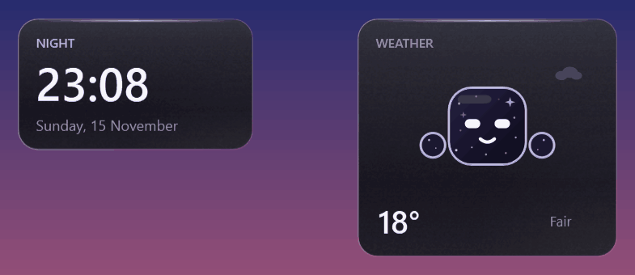</td>
<td width="50%" valign="top"><b>Liquid Glass</b> The wallpaper shows through the card, with a soft light on its edge. Three strengths, or off. 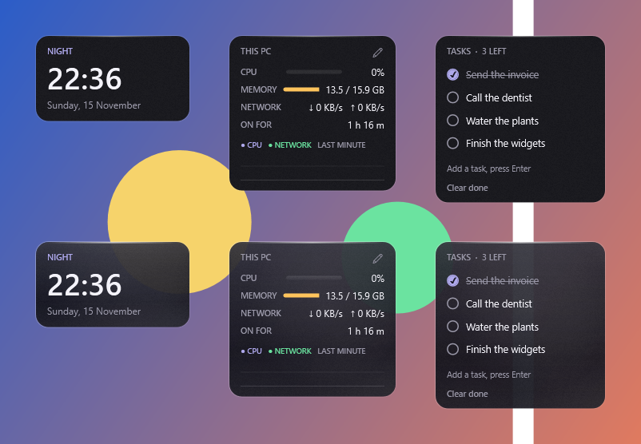</td>
</tr>
<tr>
<td width="50%" valign="top"><b>A menu on every card</b> Right-click a card: size, lock, line up, glass, hide at the screen edge, and which profile it shows in. 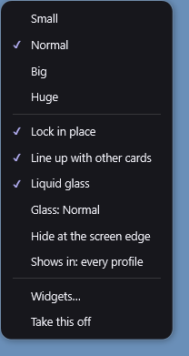</td>
<td width="50%" valign="top"><b>The tray menu</b> Lock every card, line them up, join them, and switch between the Work and Game profiles. 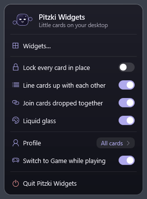</td>
</tr>
</table>

- **Sits on the desktop.** Cards stay under every window, like icons. They never steal the keyboard and never show in the taskbar or Alt+Tab.
- **Lines up by itself.** Drag a card near another or near the screen edge and it snaps into place. Hold **Alt** to place it freely.
- **Four sizes.** Small, Normal, Big and Huge, from the right-click menu.
- **More than one screen.** Each card stays whole on the screen you put it on.
- **Hide at the screen edge.** A card can tuck behind the edge and slide out when you touch it.
- **Profiles.** Put cards in **Work** or **Game**. With *Switch to Game while playing* on, the Game cards appear by themselves when a game starts.
- **Live numbers.** Nothing jumps: numbers roll up or down, bars slide, colours fade, new rows slide in.
- **Light on your PC.** Cards hidden behind a full-screen window or game stop drawing, and animations are capped at 30 frames a second.
- **Start menu and start with Windows.** Both are switches in the Widgets window.

## What each card uses

Nothing here needs an account with us, because there is no "us": the app has no server. Each card reads only what it needs, either from your own PC or from a public service, and only while the card is on your desktop.

| Card | Looks at, on your PC | Asks online | Needs |
|---|---|---|---|
| **Pitzki** | The other cards; key presses (counted, never which keys); which app sent a notification | Nothing | - |
| **Clock** | The PC's clock | Nothing | - |
| **Calendar** | The PC's clock | Nothing | - |
| **Weather** | The city you type | Open-Meteo (weather), GeoJS only if you press *Find my location* | - |
| **Note** | What you type | Nothing | - |
| **Tasks** | What you type | Nothing | - |
| **Timer** | The PC's clock | Nothing | - |
| **Focus rounds** | The PC's clock | Nothing | - |
| **Countdown** | The date you pick | Nothing | - |
| **What's next** | The Windows calendar on this PC, read only | Nothing | A calendar account added to Windows |
| **Calculator** | What you type | Frankfurter (exchange rates) for money | - |
| **World clock** | Windows time zones | Nothing | - |
| **Photos** | The folder you pick | Nothing | - |
| **Shortcuts** | The programs and folders you add | Nothing | - |
| **Stocks** | The stocks you pick | Yahoo Finance | - |
| **Stock chart** | The stock you pick | Yahoo Finance | - |
| **My portfolio** | The shares you type in | Yahoo Finance | - |
| **Indexes** | - | Yahoo Finance | - |
| **Market hours** | - | Yahoo Finance (trading hours) | - |
| **Pretend portfolio** | Your pretend trades | Yahoo Finance | - |
| **Higher or lower?** | Your guesses | Yahoo Finance | - |
| **Market news** | The stocks you pick | Yahoo Finance | - |
| **Crypto** | - | Yahoo Finance | - |
| **Dollar & euro** | - | Yahoo Finance | - |
| **Money converter** | What you type | Yahoo Finance | - |
| **This PC** | Windows performance counters | Nothing | - |
| **Drives** | Windows | Nothing | - |
| **Batteries** | Windows Bluetooth battery levels | Nothing | Devices that report a battery |
| **Copied** | The clipboard, in memory only | Nothing | - |
| **Clips** | Your Videos and Pictures folders, Steam screenshots | Nothing | - |
| **Screen time** | The name of the program in front | Nothing | - |
| **Claude usage** | Claude Code's own sign-in on this PC | Anthropic (your usage) | Claude Code |
| **Music** | Windows media controls | LRCLIB (timed lyrics, by song name) | - |
| **Discord** | Discord's app on this PC, through Pitzki's sign-in | Discord (avatars) | Discord + Pitzki |
| **Sound** | Windows audio mixer, microphone and camera in use | Nothing | - |
| **Steam** | Steam's own files on this PC | Nothing | Steam |
| **CS2 inventory** | Your Steam ID from Steam on this PC | Steam Community (public inventory), Skinport (prices) | Steam, a public inventory |
| **All my Steam** | Same as CS2 inventory and Steam items | Steam Community, Skinport | Steam |
| **Skin watch list** | The skins you add | Skinport (prices) | - |
| **Is opening worth it?** | Your CS2 inventory | Skinport (prices), case odds on GitHub | - |
| **Steam items** | Your Steam ID from Steam on this PC | Steam Community (inventory and market) | Steam, a public inventory |
| **Game updates** | Your installed Steam games | Steam's public news | Steam |
| **Last game** | Pitzki's last-game summary, the ROB RUN log | Nothing | Pitzki, or ROB RUN |

## Games

Some cards are made for players. None of them touch a game's files or memory, and none of them run inside a game.

| Game | What you get | Where it comes from |
|---|---|---|
| **Counter-Strike 2** | What your inventory is worth, how it moved since yesterday, your biggest movers, a watch list with a note when a skin drops to your price, and which cases are worth opening | Your public Steam inventory, prices from Skinport, case odds published by Valve |
| **Counter-Strike 2** match | Score, map, kills and deaths of your last match on the *Last game* card | Pitzki, through Valve's own Game State Integration |
| **Fortnite** | Place, eliminations and damage of your last match on the *Last game* card | Pitzki, from the replay file Fortnite saves on your PC |
| **Roblox** | Which game you played, for how long, and the server you were on | Pitzki, from the log file Roblox writes |
| **ROB RUN** (Roblox) | Your run, live, while you play | The game's log file |
| **Any Steam game** | What is downloading and how far along, what you played last, and what changed in the latest patch | Steam's own files on your PC, and Steam's public news |
| **Any game** | The *Game* profile turns on by itself while a game is running, and Pitzki cheers you on with a headset | The list of running programs (names only) |
| **Discord** | Your voice channel, who is talking, Mute and Deafen | Discord's own app on your PC, through Pitzki's sign-in |
| **Steam items** | What your trading cards, backgrounds and emoticons are worth | Your public Steam inventory and the Steam market |

## Privacy

- **No account, no server, no tracking.** The only things that leave your PC are the questions a card has to ask, listed in the table above (your city for the weather, the stocks you picked, your Steam ID for the inventory).
- **Copied** keeps the last things you copied **in memory only**. They are never written to disk, they are gone when the card closes, and anything a password manager marks as private is skipped.
- **Screen time** keeps program names and minutes in a file on your own PC. It never sees what is inside a window.
- **Pitzki's reactions** count key presses to know you are typing fast, but never which keys. For new messages it looks only at which app sent a notification, never at the text.
- **Claude usage** uses the sign-in Claude Code already saved on your PC, and only reads how much of your plan is used. It never changes or renews that sign-in.
- **Discord** uses the sign-in Pitzki already made, and never renews it.
- Your cards and settings are in `%LocalAppData%\PitzkiWidgets\board.json`.

## Install

1. Download `PitzkiWidgets.exe` from the [Releases page](https://github.com/yahavpenso/PitzkiWidgets/releases/latest).
2. Run it. Nothing else needs to be installed: it carries everything it needs inside.

**Windows may show "Windows protected your PC" the first time.** That appears for any app that isn't sold through a store or signed with a paid certificate. Choose **More info**, then **Run anyway**.

**Using it**

- There is no main window. The app lives in the tray, next to the clock. Click its icon and choose **Widgets…** to pick cards.
- **Drag** a card to move it. **Right-click** it for its menu. Cards with a pencil (stocks, This PC, the watch list...) are set up by clicking the pencil.
- To quit, right-click the tray icon and choose **Quit Pitzki Widgets**.

**Needs:** Windows 10 (version 2004 or newer) or Windows 11, 64-bit.

## Questions

**Does it slow down games?** No. Cards sit under every window, stop drawing while a full-screen game covers them, and use about as much processor as a music player.

**Do I need Pitzki (the notch app)?** No. The only card that reads from Pitzki is *Last game*. Everything else works on its own.

**Why are some cards empty?** A few cards need something on your PC: the Steam and CS2 cards need Steam, *Claude usage* needs Claude Code, *Discord* needs Discord and Pitzki's Discord sign-in, *ROB RUN* needs the game.

## Building from source

Pitzki Widgets shares part of its code with Piztki (the mascot and a few services), so this repository builds only next to a Piztki folder that has those files. The ready-made exe on the [Releases page](https://github.com/yahavpenso/PitzkiWidgets/releases/latest) has everything in it.
