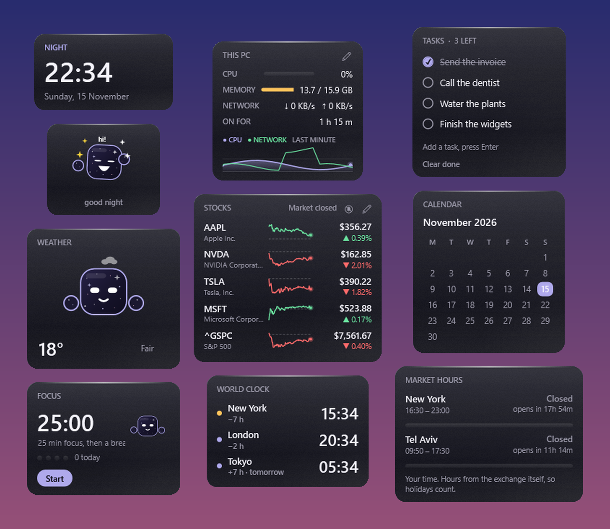

# Pitzki Widgets

**Little cards for your Windows desktop.** A clock, the weather, your tasks, the stock market, your PC, your music and your games, each on its own small card that sits right on the wallpaper. Pitzki, the night-sky cube from [Piztki](https://github.com/yahavpenso/Piztki), lives in them too.

Free. No account, no ads, no tracking.

## The cards

**Everyday**
- **Pitzki**: he sits on the desktop and keeps you company, and now and then goes for a walk
- **Clock**, **Calendar**, **World clock**
- **Weather**: the temperature outside, with Pitzki out in it
- **Note** and **Tasks**: written straight on the desktop
- **Timer**, **Focus rounds** and **Countdown**
- **What's next**: the next things in this PC's calendar
- **Calculator**: sums, units and money, answered as you type
- **Photos** and **Shortcuts**

**Money**
- **Stocks**, **Stock chart**, **My portfolio**, **Indexes**, **Market hours**, **Market news**
- **Pretend portfolio**: $10,000 of play money to buy and sell real stocks
- **Higher or lower?**: guess if a stock goes up tomorrow
- **Crypto**, **Dollar & euro**, **Money converter**

**Your PC**
- **This PC**: processor, memory, network, and a graph of the last minute
- **Drives**, **Batteries**, **Copied**, **Clips**, **Screen time**
- **Claude usage**: how much of your Claude plan is used (needs Claude Code on this PC)

**Music and games**
- **Music**: whatever is playing, with the cover and the buttons
- **Discord** and **Sound**
- **Steam**, **Game updates**, **Last game**
- **CS2 inventory**, **All my Steam**, **Skin watch list**, **Is opening worth it?**, **Steam items** (need Steam)

Cards snap to each other and to the screen edges, join into one card when you drop one on another, work on more than one screen, and can hide at the screen edge. Every number rolls when it changes, and Liquid Glass lets the wallpaper show through.

## Install

1. Download `PitzkiWidgets.exe` from the [Releases page](https://github.com/yahavpenso/PitzkiWidgets/releases).
2. Run it. Nothing else needs to be installed.

**Windows may show "Windows protected your PC" the first time.** That appears for any app that isn't sold through a store or signed with a paid certificate. Choose **More info**, then **Run anyway**.

There is no main window. Click the Pitzki Widgets icon next to the clock and choose **Widgets…** to pick your cards. Right-click a card to resize it, lock it, or take it off. To quit, right-click the tray icon and choose **Quit**.

## Building from source

Pitzki Widgets shares some of its code with Piztki (the mascot and a few services), so this repository builds only next to a Piztki folder that has those files. The ready-made exe on the Releases page has everything in it.
